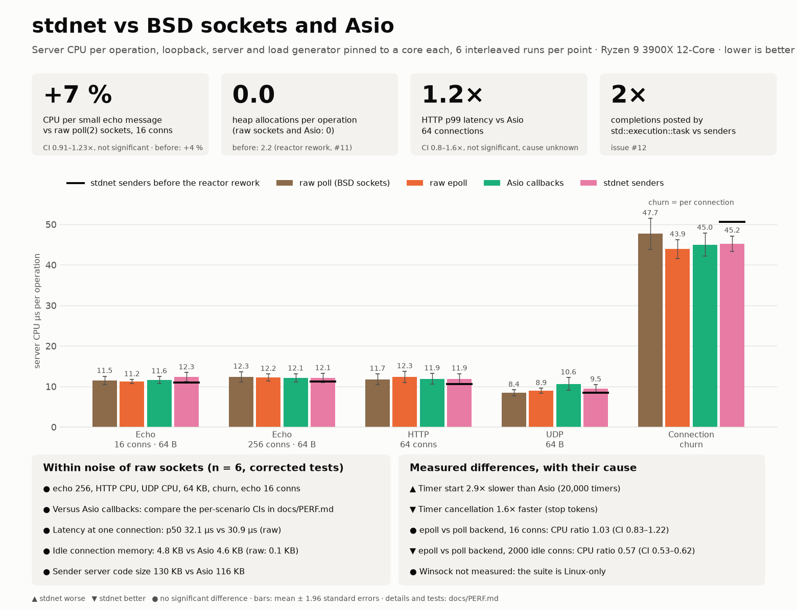
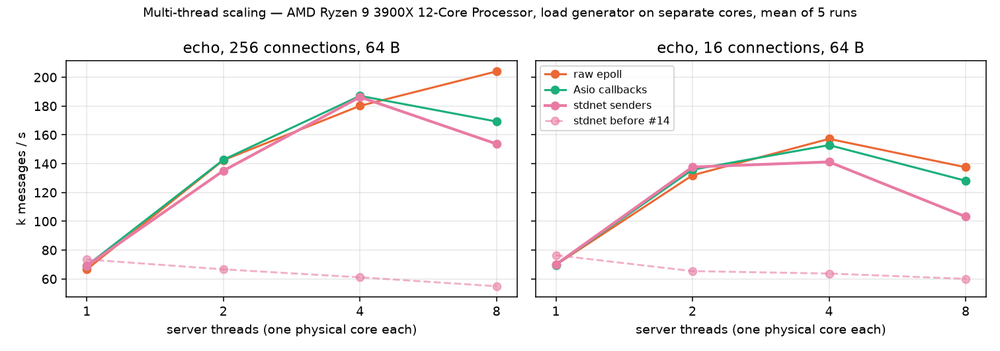

# stdnet — a prospective C++29 `<network>`

`<network>` was not part of C++26. stdnet is a header-only implementation of what a C++29
networking header can realistically look like, given where WG21 stands in 2026:

* **sender/receiver everywhere** — every asynchronous operation is a `std::execution` sender,
  usable with sender algorithms or `co_await`-ed in `std::execution::task`;
* **two layers** — a socket layer shaped after P2762 (`async_accept`, `async_receive`,
  `async_write`, …) and a TAPS connection layer after P3185/P3482 (`preconnection`,
  `initiate`, `listen`, `connection`);
* **no data lost in the error channel** — byte counts are values, end of stream is
  `set_value(0)`, and `| as_expected` turns `error_code`s into `std::expected` values;
* **secure by default** — the TAPS layer requires an explicit opt-out for cleartext.

The specification is in [docs/SPEC.md](docs/SPEC.md); the survey of the papers it is based on
is in [docs/RESEARCH.md](docs/RESEARCH.md); measurements against raw sockets and Asio are in
[docs/PERF.md](docs/PERF.md).

## Performance



With the reactor of [#11](https://github.com/ambroise-leclerc/stdnet/issues/11)
(persistent per-descriptor state, epoll registered once, writability armed only while a write is
blocked), stdnet makes **no heap allocation and no `epoll_ctl` per operation** (it made 2–3
allocations per message), and its server CPU per small echo message at 16 connections is the
same as raw `poll(2)` sockets within noise (ratio 1.00, 95 % CI 0.88–1.12×; +4 % before) and as
Asio. The epoll backend costs at most 4 % more CPU than the poll backend with every connection
active (paired study, margin 10 %), and 0.56× / 0.24× with 2 000 / 10 000 mostly idle
connections. `stdnet::task` (a `std::execution::task` bound to the io_context,
[#12](https://github.com/ambroise-leclerc/stdnet/issues/12)) posts one completion per operation like the sender API
(it posted two) and costs the same CPU (ratio 0.96–1.01). Timers start without allocation, faster than Asio ([#13](https://github.com/ambroise-leclerc/stdnet/issues/13)). Known, tracked inefficiencies: HTTP p99 latency (1.5× Asio here, not significant after
correction for multiple tests), compile time. The black ticks of the figure are stdnet before the
rework. The figure comes from the single performance test, `python3 bench/run.py` (about 100
seconds, server and load generator pinned to one core each, interleaved repetitions) and the
paired epoll / poll study (`--only backend`, 7 minutes); its source data are in
`bench/results/timer-queue/` (baseline `bench/results/2026-10-12-figure/before-0ec17e8/`) and `bench/results/2026-10-12-backend/`, and it is drawn by
`python3 bench/infographic.py <results> docs/infographic.png [<baseline results> [<backend study>]]`.
Two runs of the same binary differ by about ±5 % in CPU per operation, so read small differences
with that in mind; the counters (allocations, completions) are exact. Method and statistics:
[docs/PERF.md](docs/PERF.md).

### Threads



With several threads running one `io_context`, stdnet used to get *slower*: every system call was
made under the context's single mutex, so a second thread only queued on it (0.75–0.91× of one
thread's throughput with 2–8 threads, 15–128 µs of mutex waiting per message). Since
[#14](https://github.com/ambroise-leclerc/stdnet/issues/14) the system calls are made outside the
mutex, and on a 12-core machine, each server thread on its own physical core and the load
generator on others, stdnet scales like Asio and raw epoll up to 4 threads (about 2.0× with 2
threads, 2.7× with 4, 256 connections; the dashed line is stdnet before the change, measured in
an earlier campaign on the same machine). At 8 threads all three flatten or fall and stdnet is
the lowest with 16 connections; why is not established. Reproduce with
`python3 bench/run.py --only scaling --reps 5 --scaling-conns 256 16`, draw with
`python3 bench/scaling_figure.py <results> docs/scaling.png [<baseline results>]`; method and
data in [docs/PERF.md](docs/PERF.md#multi-thread-scaling-14).

## Example

```cpp
#include <network>
namespace net = stdnet;          // std::net in the standard
namespace ex  = stdnet::ex;      // std::execution
using net::ip::tcp;

net::task<void> serve(tcp::socket s) {   // net::task: a std::execution::task bound to the io_context
    char buf[4096];
    while (std::size_t n = co_await net::async_receive(s, net::buffer(buf)))   // 0 = end of stream
        co_await net::async_write(s, net::buffer(buf, n));
}

net::task<void> accept_loop(tcp::acceptor& acc, ex::counting_scope& scope,
                           net::io_context::scheduler_type sch) {
    for (;;) {
        tcp::socket s = co_await net::async_accept(acc);
        // log_errors: see examples/http_hello.cpp (spawn only takes senders that cannot fail)
        ex::spawn(ex::starts_on(sch, log_errors(serve(std::move(s)))), scope.get_token());
    }
}
```

With the TAPS layer, the application states what it needs and the library picks the transport:

```cpp
net::preconnection pc(net::remote_endpoint().with_hostname("example.com").with_port(80),
                      net::transport_properties::reliable_stream(),
                      net::security_parameters::disabled());     // cleartext must be explicit
net::connection conn = co_await net::initiate(sch, std::move(pc));
co_await net::async_send(conn, net::buffer(request));
```

Complete programs: [examples/http_hello.cpp](examples/http_hello.cpp) (HTTP/1.1 server, one
coroutine per connection), [examples/taps_get.cpp](examples/taps_get.cpp) (HTTP client over
the TAPS API), [examples/echo_senders.cpp](examples/echo_senders.cpp) (sender algorithms only).

## Building

Requirements: C++23 compiler (GCC 13+, Clang 18+, MSVC 17.10+), CMake 3.25+.

```sh
cmake -S . -B build
cmake --build build
ctest --test-dir build
```

`std::execution` comes from the standard library when it provides senders
(`__cpp_lib_senders`); otherwise CMake fetches NVIDIA's [stdexec](https://github.com/NVIDIA/stdexec)
(pinned commit). Consume stdnet with `add_subdirectory` / `FetchContent` and link
`stdnet::stdnet`.

## Using it from WebFront

[contrib/webfront/TCPNetworkingStdnet.hpp](contrib/webfront/TCPNetworkingStdnet.hpp) is a
drop-in networking provider for [WebFront](https://github.com/ambroise-leclerc/webfront): it
exposes the callback surface WebFront uses today on top of stdnet senders, so the Networking TS
dependency can be dropped first and the code migrated to senders/coroutines afterwards.
See [contrib/webfront/README.md](contrib/webfront/README.md).

## Status

Version 0.1. Tested on Linux with GCC 13 and Clang 18, with the epoll and poll backends, under
AddressSanitizer, UndefinedBehaviorSanitizer and ThreadSanitizer. The macOS (poll) and Windows
(WSAPoll) code paths are written and in the CI matrix but not yet verified. TLS, QUIC and the
other extensions listed in SPEC §10 are not implemented.

## Development and releases

`develop` is the default branch and the integration branch for ongoing work. Create
feature and fix branches from `develop`, and target `develop` with their pull requests.

`main` is reserved for official releases. To prepare a release, open a pull request
from `develop` to `main`. Merging requires an up-to-date branch and all nine CI checks
to pass, including platform builds, sanitizers, and the benchmark smoke test. These
requirements also apply to administrators; force pushes and branch deletion are disabled.
No additional reviewer approval is required.

After merging the release pull request, create the version tag (for example, `v0.1`)
on the released commit in `main` and publish the corresponding GitHub release. Merge
`main` back into `develop` before continuing development so both branches share the
release history. Release fixes follow the same pull request and CI requirements.

## License

Apache License v2.0 with LLVM Exceptions.
