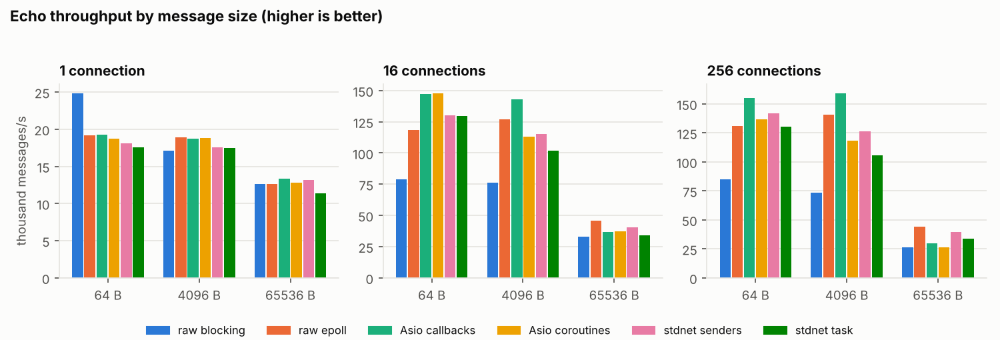
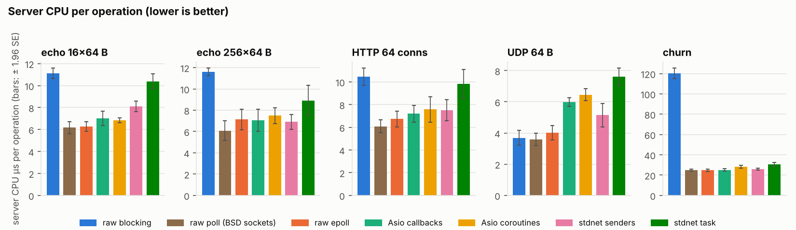
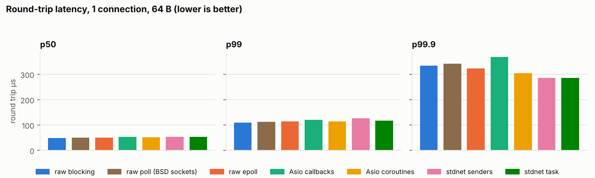
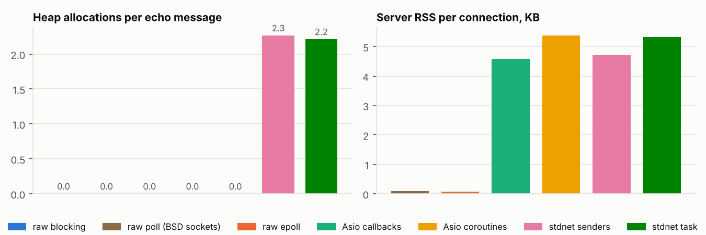

# stdnet performance

Status of stdnet against raw sockets and Asio, and the ranked list of improvements it implies.
Suite and method: [bench/README.md](../bench/README.md). Full tables of the run below:
[bench/results/2026-10-11/tables.md](../bench/results/2026-10-11/tables.md); raw data in
`results.json` next to it. The effect of the reactor change of #11 (measured on another machine,
before and after) is in [its own section](#effect-of-11-persistent-reactor-state).

## Run of 2026-10-11

Intel Xeon @ 2.80 GHz, **2 cores**, 8 GB, Linux 6.18, GCC 13.3 `-O2`, Asio 1.38.2, stdexec
`7df6de8`. Loopback; server and load generator share the two cores; **6 repetitions** of 3 s per
point after 1 s of warm-up. Coefficient of variation (sample standard deviation / mean): median
8.9 % for server CPU per operation, 9.4 % for throughput, up to 22 %. All runs passed validation
(no connection error, no lost datagram, server alive, counters present).

**What is claimed, and how.** Differences are tested with Welch's t-test; the table in
"Statistical significance" gives the ratio, its 95 % confidence interval and p, with a Bonferroni
correction over the 32 comparisons made. This page states a difference only when it passes that
test; the others are reported as *not significant at n = 6*, which means "not distinguishable
from noise on this machine", not "equal". Counters (allocations, system calls, posts) are
deterministic and need no test. An earlier version of this page, with 3 repetitions, called
several noise-level gaps wins or losses; those statements have been removed or qualified.

**Measurement window.** Server CPU, allocations, reactor counters and system calls are sampled
at the start and end of the load generator's measured window, and divided by the operations of
that same window; memory per connection is read at the end of the window with every connection
still open.

**Read throughput with care**: with two cores the load generator competes with the server, so
absolute message rates mostly say how CPU is shared (the raw epoll loop even comes out slower
than the raw poll loop at 256 connections, a gap that is not significant on CPU per message).
The comparable metric is **server CPU per operation**, together with allocations, system calls
and reactor counters. Linux only: Winsock is not measured (see below).

## Effect of #11: persistent reactor state

The reactor of #11 keeps the descriptor entry alive until `close()`/`cancel()`, registers it once
with epoll (`EPOLLIN | EPOLLOUT | EPOLLET`), and reuses its event buffers. It was measured **on a
different machine from the run above**, with the same suite, before and after, so that the two
campaigns are comparable with each other (and not with the Xeon numbers of this page):
AMD Ryzen 9 3900X (24 threads; the load generator no longer competes with the server), Linux
7.0, GCC 15 `-O3` (CMake `Release`), Asio 1.38.2, stdexec `7df6de8`, 6 repetitions of 3 s per
point. Before: `develop` at `0ec17e8`
([results](../bench/results/2026-10-11-develop/tables.md)); after: the branch of #17
([results](../bench/results/2026-10-11-reactor/tables.md)). The two campaigns ran one after
the other (not interleaved, 46 min each); Asio and the raw epoll loop, which did not change,
serve as controls: their before/after ratios are all within 0.97–1.05, so the machine did not
drift measurably. Full comparison with intervals:
[vs-develop.md](../bench/results/2026-10-11-reactor/vs-develop.md) (`bench/compare.py`;
44 comparisons, Bonferroni threshold p < 0.0011).

**Counters (deterministic, no test needed)**

| | before | after |
|---|---|---|
| heap allocations per message, echo / HTTP / UDP / 10 000 idle connections (senders) | 2.0–3.0 | **0.00** |
| `epoll_ctl` per message, 1 connection / 64 connections (reactor counters) | 1.97 / 0.70 | **0.00** |
| allocations per connection, churn (senders / `task`; Asio and raw: 1.0) | 8.9 / 10.9 | 3.0 / 5.0 |
| memory per idle connection (senders) | 4.7 KB | 4.7 KB |

The remaining allocations of the churn scenario are the session state of each connection, not the
reactor.

**CPU per operation.** Smaller than the counters suggest, and mostly not distinguishable from
noise at n = 6 once corrected: echo, 1 connection × 64 B 19.6 → 17.2 µs (ratio 0.88, CI
0.81–0.95, p = 0.004, *not significant* at the corrected threshold); 16 connections 12.4 → 11.7 µs
(0.94, CI 0.87–1.00, p = 0.06); no change at 256 connections, 64 KB messages, HTTP, UDP, idle
connections and churn (ratios 0.95–1.01). The Asio and raw controls did not move. The allocator
and the syscalls removed were cheap compared with the 11–12 µs the kernel and the TCP stack
cost per message on this machine.

**Tail latency.** The significant effects are on p99: HTTP, 64 connections, senders 3.2 → 1.9 ms
(0.59×, CI 0.47–0.72, p = 0.0001); echo with `task`, 16 connections 881 → 606 µs (0.69×,
p = 0.0003) and 256 connections 42 → 18 ms (0.43×, p < 0.0001). For senders the echo p99 also
falls (16 connections 528 → 377 µs, 256 connections 10.9 → 7.1 ms) but not significantly after
correction. **One regression**: HTTP p99 with `task` rises from 2.6 to 7.8 ms (2.96×, CI
1.05–4.87, p = 0.0005); the interval is wide and the cause is not identified — it is the only
scenario where the tail got worse, to be looked at with #12 (the second scheduling hop of
`task`).

**Against raw sockets and Asio, after #11** (server CPU per message, ratios of stdnet senders with
95 % CI; none is significant): echo 16 connections 1.00 vs raw poll (0.93–1.08), 1.02 vs raw
epoll, 1.02 vs Asio (0.96–1.08); echo 256 connections 0.96 vs raw poll, 1.03 vs raw epoll, 1.01 vs
Asio; HTTP 1.01 vs raw poll and raw epoll, 0.99 vs Asio; UDP 1.05 vs raw (p = 0.045) and 0.94 vs Asio (p = 0.04). On this
machine stdnet senders were already within +8 % of raw epoll on small echo before the change
(12.4 vs 11.5 µs); the +31 % of the Xeon run is **not** re-measured and nothing here says how much
of it #11 removes on a 2-core machine, where the load generator competes with the server.

**epoll versus poll** (the stdnet senders server on each backend, own runs, CPU per message,
ratio epoll / poll): before, 16 connections 1.07 (CI 1.01–1.12, p = 0.02), 256 connections 1.01;
after, 16 connections 1.04 (0.98–1.09, p = 0.18), 256 connections 1.04 (0.97–1.12, p = 0.22).
The gap at 16 connections shrank and is no longer distinguishable from zero, but **epoll is not
shown to be at least as good as poll**: its point estimates remain 3–4 % above, with intervals
that include parity. That acceptance criterion of #11 is not met as stated; the remaining cost
of the epoll backend is outside what #11 changed (`epoll_wait` per wakeup, mutex, ready-queue
hand-off), and a larger n would be needed to resolve a 3 % difference.

**Not changed**: two server threads (stdnet senders 72.0 k → 72.5 k msg/s, `task` 63.7 k → 65.2 k;
the many-core question of #14 is untouched), memory per connection, compile time. The poll
backend now scans the persistent entries of idle sockets at each wait; it was not measured with
10 000 idle connections.

## Summary

* **Cost over BSD sockets.** The portable raw loop (`poll`) spends 6.2 µs of server CPU per
  64-byte echo message at 16 connections; stdnet senders spend 8.1 µs: **+31 % (+1.9 µs),
  significant** (95 % CI of the ratio 1.15–1.47), the same against raw epoll (+29 %). At 256
  connections the gap shrinks to +0.8 µs and is not significant, and it is not significant for
  HTTP (+23 % vs poll, p = 0.03), 64 KB messages (+18 %), UDP (+43 %, p = 0.008) or churn
  (+3 %) after correction. Reading the intervals, stdnet costs between 0 and about 50 % more CPU
  than hand-written sockets on small messages, and the data cannot say more precisely with this
  machine and this many runs. Latency at one connection is the same (p50 52.5 vs 50.9 µs, not
  significant).
* **Against Asio**: no significant difference in CPU per message for the sender API in any
  scenario (16 connections: ratio 1.15, CI 1.01–1.30, p = 0.03 — suggestive, not established).
  The coroutine variant is significantly worse than Asio coroutines at 16 connections (1.52×,
  the double scheduling hop below). The earlier "stdnet is ahead on UDP" does **not** survive:
  5.1 µs vs Asio's 6.0, ratio 0.86, CI 0.70–1.02, p = 0.09.
* **Solid findings** (counters or large, significant effects):
  1. **2.0–2.3 heap allocations per operation** (Asio, raw: 0) and **~2 `epoll_ctl` per message**
     at one connection — from the per-descriptor map in `io_context` (**fixed by #11**, see above);
  2. **`std::execution::task` posts every completion twice** (4.0 vs 2.0 per message) and costs
     1.3–1.5× the CPU of the sender API (#12);
  3. **timer start is 3.0× slower than Asio** (68.9 vs 23.3 ms for 100 000; CI 2.27–3.64) while
     **cancellation is 2.7× faster** (15.9 vs 42.4 ms) and draining 1.3× faster (p = 0.015) (#13);
  4. **HTTP p99 latency is 2.2× Asio's** (CI 1.8–2.6, p = 0.0002) and 2.5× raw poll's at 64
     connections — significant, cause unknown, to be re-measured after #11;
  5. **compile time** 13.2 s vs 6.6 s per translation unit (stdexec headers); code size of the
     sender server (102 KB `.text`) is below Asio's (118 KB);
  6. memory of an idle connection: 4.7 KB vs 4.6 KB for Asio (ratio 1.03).
* The single-mutex design could not be judged on two cores (#14).





| Implementation | echo 16×64 B | echo 256×64 B | HTTP, 64 conns | UDP 64 B | churn |
|---|---|---|---|---|---|
| raw blocking | 77 919 · 11.1 | 75 309 · 11.6 | 84 754 · 10.5 | 253 834 · 3.7 | 10 447 · 120.1 |
| raw poll (BSD sockets) | 149 645 · 6.2 | 161 480 · 6.1 | 159 607 · 6.1 | 258 047 · 3.6 | 20 752 · 24.9 |
| raw epoll | 136 833 · 6.3 | 121 887 · 7.1 | 127 346 · 6.7 | 231 559 · 4.0 | 20 751 · 24.7 |
| Asio callbacks | 128 077 · 7.0 | 132 750 · 7.1 | 127 035 · 7.2 | 161 570 · 6.0 | 21 347 · 25.0 |
| Asio coroutines | 132 230 · 6.8 | 126 493 · 7.5 | 127 595 · 7.6 | 149 105 · 6.5 | 24 476 · 28.3 |
| stdnet senders | 117 986 · 8.1 | 141 436 · 6.9 | 130 645 · 7.5 | 190 418 · 5.1 | 25 634 · 25.8 |
| stdnet task | 92 911 · 10.4 | 114 648 · 8.9 | 101 728 · 9.8 | 129 129 · 7.6 | 26 032 · 30.4 |

*Operations per second · server CPU µs per operation (means of 6 runs; the error bars of the
figure above are ±1.96 standard errors).*

## stdnet versus BSD sockets (and Winsock)

Server CPU per operation, µs. `raw poll` is the portable BSD model (non-blocking sockets +
`poll`, the same readiness model as Winsock's `WSAPoll`); `raw epoll` is the best a Linux
readiness loop can do.

| Scenario | raw poll | raw epoll | Asio | stdnet senders | stdnet − raw poll | significant? |
|---|---|---|---|---|---|---|
| echo 16 conns × 64 B | 6.2 | 6.3 | 7.0 | 8.1 | +1.9 (+31 %) | yes |
| echo 256 conns × 64 B | 6.1 | 7.1 | 7.1 | 6.9 | +0.8 (+14 %) | no |
| echo 16 conns × 64 KB | 22.4 | 22.0 | 24.7 | 26.4 | +4.0 (+18 %) | no |
| HTTP 64 conns | 6.1 | 6.7 | 7.2 | 7.5 | +1.4 (+23 %) | no (p = 0.03) |
| UDP 64 B | 3.6 | 4.0 | 6.0 | 5.1 | +1.5 (+43 %) | no (p = 0.008, above the corrected threshold 0.0016) |
| churn | 24.9 | 24.7 | 25.0 | 25.8 | +0.8 (+3 %) | no |

The same table with confidence intervals for every pair is in
[tables.md](../bench/results/2026-10-11/tables.md). The only effect that is both large and
robust is the small-message echo at 16 connections; on the other scenarios stdnet is within
noise of both the raw sockets and Asio, but the intervals are wide (up to ±25 % at n = 6).
Heap allocations are the unambiguous cost: 0 for the raw loops, 2.0–2.3 per operation for stdnet.

**Winsock.** The suite is Linux-only (epoll, `/proc`, `strace`), so no Winsock number exists.
stdnet's Windows backend (`WSAPoll`) is exercised by the conformance tests in CI, not
benchmarked; a Windows port of `raw_poll` and of the load generator would be needed to compare
it with raw Winsock. The Linux `raw poll` result is the closest available proxy for the cost of
the portable readiness model, not a Winsock measurement.





## What the diagnostics show

**Allocations** (before #11). Tracing the allocations of the sender server (`BENCH_TRACE_ALLOCS`) attributes
them to `std::unordered_map::operator[]` in `io_context::start_io()`: the entry of a descriptor
is created when an operation starts and erased as soon as no operation is pending, so each
operation allocates (and frees) a 56-byte node — 2 operations, 2 allocations per echo message.
The remainder came from the event `std::vector` built at each reactor wait. Both are gone since #11.

**Reactor counters** (instrumented build, per echo message, measurement window; Xeon run, before #11 —
`epoll_ctl` is 0 everywhere after it):

| Build | conns · threads | operations started | completed in `start()` | had to wait | `epoll_wait` | `epoll_ctl` | posts |
|---|---|---|---|---|---|---|---|
| senders | 1 · 1 | 2.00 | 1.00 | 0.99 | 0.99 | 1.99 | 2.00 |
| senders | 64 · 1 | 2.00 | 1.75 | 0.25 | 0.02 | 0.49 | 2.00 |
| task | 1 · 1 | 2.00 | 1.02 | 0.98 | 0.98 | 1.96 | 4.00 |
| task | 64 · 1 | 2.00 | 1.84 | 0.16 | 0.02 | 0.32 | 4.00 |

Every operation that has to wait costs an `EPOLL_CTL_ADD` and an `EPOLL_CTL_DEL` (1.99 calls for
0.99 waiting operations). The portable poll backend, which rebuilds its array without system
calls, uses **significantly less CPU than epoll at 16 connections** (ratio 1.16 in favour of
poll, CI 1.09–1.22; 140 k vs 121 k msg/s) and has a **2.3× lower p99 at 256 connections**
(8.8 vs 20.5 ms, p = 0.002); at 256 connections the CPU difference is not significant. With
`task`, posts double: the coroutine is re-scheduled after each `co_await` even though the
operation already completed on the right context. (The backend table is measured in its own
runs, so a point can differ slightly from the same point of the echo table.)

**System calls** inside the window at 16 connections: one `recvmsg`/`recvfrom` and one
`sendmsg`/`sendto` per message for stdnet, Asio and the raw loop alike (Asio adds 0.13 `epoll_wait`). Under `strace` the
server is slowed down so much that almost every operation finds its socket ready, so this
profile shows which calls are made, not how often operations wait — the counters above do.

**Operation states**: 112 bytes for `async_receive`, 120 for `async_write`, 200 for a
receive-then-write iteration, 80 for a timer. A 64-byte-message server needs no heap beyond its
per-connection state once #11 is fixed.

**Memory per connection** (10 000 connections, 100 active, read with the connections open):
0.1 KB for the raw loops, 4.6 KB Asio callbacks, 4.7 KB stdnet senders, 5.3–5.4 KB for the
coroutine variants. Most of it is the touched part of each session's 64 KB receive buffer.
Kernel socket buffers are not part of the process RSS.

## Hypotheses of issue #10

| Hypothesis | Verdict |
|---|---|
| Single mutex, system calls under the lock, limits scaling | **Not measurable here** — on 2 cores every library slows down with a second server thread (the raw epoll loop, with one reactor per thread, loses only 9 %: 149 k → 135 k msg/s, against 152 k → 111 k for stdnet senders); condition-variable waits stay ≤ 0.01 per message. Needs a many-core run (#14). |
| `epoll_ctl(MOD)` at each interest change | **Confirmed, and worse**: ADD + DEL per waiting operation (1.99 per message at one connection); poll beats epoll at 16 connections. **Fixed by #11**: 0 per message; epoll vs poll no longer distinguishable. |
| Map lookup per readiness event | **Confirmed, and worse**: one node allocation per operation, the main source of allocations. **Fixed by #11**: 0 allocations (the lookup itself remains). |
| Immediate success still goes through the ready queue | **Confirmed in counts** (1.75 of 2 operations per message at 64 connections); cost not isolated (#15). |
| Buffer sequences copied; resolver allocations | Single-buffer copies are free; the resolver is not exercised by these scenarios — not measured. |
| iovec array rebuilt at each partial transfer | **Not a bottleneck**: at 64 KB per message stdnet is within noise of Asio (26.4 vs 24.7 µs at 16 connections, ratio 1.07, p = 0.45; 30.2 vs 36.5 µs at 256). |

## Ranked improvements

| # | Change | Evidence | Expected effect |
|---|---|---|---|
| 1 | ~~Per-socket reactor state, registered once, edge-triggered (#11)~~ **done** (#17) | 2.0–2.3 allocs/op; ~2 `epoll_ctl`/msg; poll > epoll at 16 conns | achieved: 0 allocations, 0 `epoll_ctl`, lower p99; CPU gain small; epoll ≥ poll not shown |
| 2 | Remove the second scheduling hop of `task` (#12) | 4.0 vs 2.0 posts/msg; task 1.3–1.5× the CPU of senders (echo, UDP; significant) | task ≈ senders |
| 3 | Allocation-free timer queue (#13) | 68.9 vs 23.3 ms to start 100 000 timers (3.0×) | start within 1.5× of Asio |
| 4 | HTTP p99 latency, 2.2× Asio (significant) | explain after #11 | — |
| 5 | Scaling run on ≥ 8 cores, then lock splitting if needed (#14) | inconclusive on 2 cores | — |
| 6 | Bounded inline completion (#15) | 1.75 immediate completions/msg all queued | lower CPU and latency at high load, to be measured |
| 7 | Compile time | 13.2 s vs 6.6 s (Asio) per TU | depends on stdexec / a bundled kernel; tracked, no issue yet |

## Re-running

```sh
python3 bench/run.py --build build-bench/bench --out bench/results/<date> --reps 6
python3 bench/run.py --build build-bench/bench --out bench/results/<date> --only echo,backend   # partial re-run, merged
python3 bench/report.py bench/results/<date>
```

`run.py` exits with status 1 if any run is invalid. Each improvement above should land with a
partial re-run and an update of this page.
